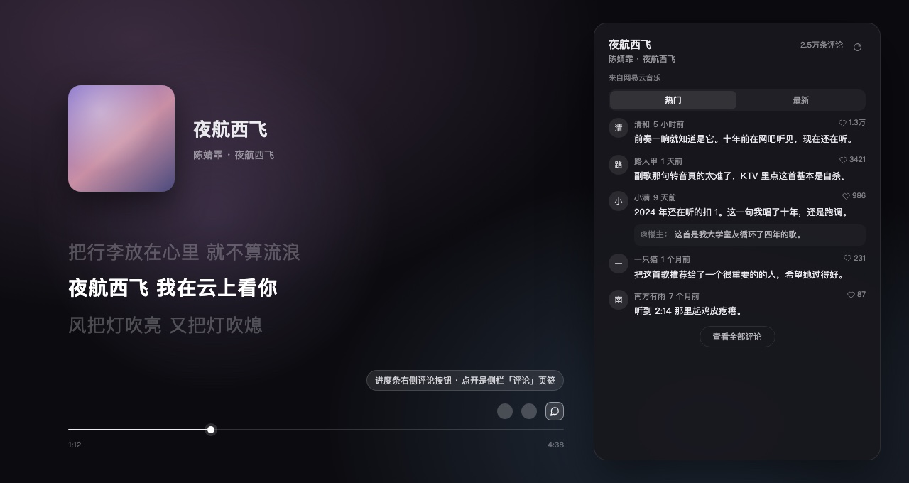

# 歌曲评论 · Song Comments

Folia（Folium 1）模组：播放页进度条右侧多一个评论按钮，点开后播放器侧栏出现「评论」页签，显示当前这首歌在**网易云音乐**的评论。



## 功能

- **进度条按钮 → 侧栏页签**：按钮排在进度条尾部（和「歌曲资料」等信息类按钮同区），点一下直接打开侧栏并切到「评论」。小窗（宽 < 600 或高 < 220）自动隐藏按钮，不挤占控件。
- **页签有自己的图标**：侧栏窄到只显示图标时，「评论」页签是对话气泡，不再是所有模组共用的拼图。宿主 0.7.x 的 `playerPanelTabs` 不接受 `icon` 字段（渲染层写死 lucide `Puzzle`），这里用官方 `styles` 注册表注入一条 CSS，用 `[data-ponder-panel-tab-button*="song-comments"]` 只命中自己那个按钮，把 svg 换成 16px 的 mask 图标（`currentColor`，跟随常态/选中/hover 颜色）。放得下文字时仍然是「评论」两个字，与其他页签一致。
- **热门 / 最新**：热门优先走 `comment_hot`（带 `type: 0` 指明是歌曲）；宿主返回结构不认、或者这个端点报错时，自动退到 `comment_music` 自带的 `hotComments`，再退一步按点赞数取前 N 条——所以热门不会空着。热门只有一屏，底部给「查看全部评论」跳到最新。
- **最新**：走 `comment_music` 分页，滚到底点「加载更多」。
- **段落**：昵称、相对时间、正文（超过 150 字折叠，可展开/收起）、点赞数、被回复内容（引用块）。
- **曲目匹配**：来自网易云的曲目直接用 `sourceRef.mediaId` 精确查询；本地文件 / QQ 音乐 / Spotify / 酷狗等没有网易云 ID 的曲目，按「歌名 + 歌手」检索一次，取标题与歌手最接近、时长合理的一首。面板顶部会写明「按歌名匹配到《…》」，并给一个「重新匹配」按钮。
- **状态区分**：没有播放中的歌曲、曲目没有网易云版本、这首没有热门评论、还没有人评论、权限被拒、账号未登录、请求过于频繁、网络失败——每种情况都是不同的文案，不是一句「加载失败」。
- **缓存**：同一首歌同一视图 10 分钟内不重复请求；切歌即失效。

## 设置

| 项 | 默认 | 说明 |
|---|---|---|
| 每页评论条数 | 20 | 5–50，点「加载更多」按此步长追加 |
| 非网易云曲目按歌名匹配 | 开 | 关闭后，没有网易云 ID 的曲目直接显示「没有网易云版本」，不发生任何检索请求 |
| 显示评论者头像 | 开 | 关闭后只显示昵称首字；头像加载失败也会退回首字 |

## 权限与隐私

```json
"permissions": ["platform.netease.read"],
"experimental": ["platform.raw"]
```

- 评论与检索都通过 Folium 的实验性 `platform.raw` 发起，走的是**你在 Folia 里登录的网易云账号会话**，因此启用时信任弹窗会说明「可读取你在网易云音乐上的数据」。
- **只读**：不点赞、不发表评论、不关注、不修改任何数据。写接口（`platform.netease.write`）没有申请。
- 开启「按歌名匹配」时，会把当前曲目的**歌名与歌手名**发给网易云用于检索；关闭后不发送。
- 查询结果只存在内存里，不落盘、不上传。
- 评论内容与头像版权归原作者与网易云音乐，本模组仅作展示。

## 安装

1. 把 `song-comments/` 整个目录放进 `~/Library/Application Support/Folia/mods/`（Windows：`%APPDATA%\Folia\mods\`）。
2. 重启 Folia，在「模组管理」里启用并确认权限（未签名模组会要求确认一次）。
3. 播放任意一首歌，点进度条右侧的评论图标，或直接在侧栏切到「评论」页签。

## 已知限制

- **QQ 音乐、汽水、酷狗的评论拿不到。** 宿主 `foliumShared.json` 只开放了 `platform.netease.read/write` 这一组平台直通权限，其余 provider 没有等价入口；自己签名去调 QQ 的接口既不稳定也不该塞进模组里。这些曲目的评论走「按歌名匹配网易云同名曲目」。
- `platform.raw` 是**实验性**接口，宿主小版本更新可能改行为。所以：拿不到接口时不报错崩溃，而是在面板里显示「宿主没有开放这个网易云接口」并给重试按钮。
- 面板是标准的播放器侧栏页签，不是浮层——宿主决定宽度与主题，模组只负责内容。
- **页签图标依赖一个非公开属性。** `data-ponder-panel-tab-button` 是宿主引导系统用的，不属于公开 API。宿主改名后图标会退回拼图（面板功能不受影响）。已经向 `chthollyphile/folia-major` 提了 feature request（`FEATURE-REQUEST.md`），等 `playerPanelTabs` 支持 `icon` 字段就改回官方用法并删掉这段 CSS。
- 宿主的页签容器只保证**宽度**（`fill: false` + `w-full`），高度不由它兜底，而且模组挂在 shadow root 里。所以模组自己向上找「滚动容器 / 高度写死的裁切容器」来量可用高度（跨 shadow 边界），量到就把根节点钉成 px、列表内滚；量不到就退回不限高、交给外层滚动。两种情况都能滚，不会出现「内容被裁掉且滑不动」。

## 更新日志

**1.0.3**
- 新增：「评论」页签有自己的图标（对话气泡）。宿主 0.7.x 的 `playerPanelTabs` 会丢掉 `icon` 字段，所以走官方 `styles` 注册表注入一条作用域限死在自己页签按钮上的 CSS：隐藏宿主画的拼图 svg，用 `mask-image` + `background-color: currentColor` 画 16px 气泡。只影响本模组页签，不碰别的模组、不改宿主 DOM、不需要新权限。
- 新增：`test/build_tabicon_harness.mjs`，把宿主的页签按钮结构（`button > span > svg`）连同真实 CSS 一起渲染出来，核对图标尺寸/对齐/选中态。
- 测试：67 → 82 项。

**1.0.2**
- 修：设置页显示成 `pageSize` / `matchBySearch`、组标题显示 `song-comments:settings`。宿主 schema 解析只保留**对象形式**的文案（`label: s.label && typeof s.label === 'object' ? s.label : {}`），传字符串会被静默丢掉并退回原始 key。现在 label / description 一律写成 `{ 'zh-CN': …, en: … }`，并加了断言防回归。

**1.0.1**
- 修：热门页签为空／报错。`comment_hot` 现在带 `type: 0`，并加了 `comment_music.hotComments` → 按点赞排序 两级降级。
- 修：面板不能下滑。不再依赖 `height: 100%`（在 `fill: false` 的容器里会解析成一个偏大的值，导致内容不溢出、内部不滚动、多出来的部分被外层裁掉），改为测量外层滚动容器后钉高。
- 新增：热门底部「查看全部评论」，一键跳到最新。
- 新增：`test/probe_scroll.mjs`，用真实面板容器结构（含 shadow root）在 Chromium 里断言列表确实可滚。

**1.0.0** 首发。

## 开发

```
song-comments/     模组本体（mod.json / client.mjs / preview.jpg / LICENSE）
test/smoke.mjs     jsdom 冒烟测试：按钮、页签、请求参数、热门降级、切歌、dispose
test/probe_scroll.mjs    真 Chrome 里的滚动探针：模拟宿主页签容器，断言列表可滚
test/build_harness.mjs   浏览器台架（明暗两版）用于肉眼验收
test/build_preview.mjs   用真实模组代码渲染商店预览图
test/build_tabicon_harness.mjs  复刻宿主页签按钮结构，核对图标尺寸/对齐/选中态
test/build_submit_url.mjs 生成 folium-compound「模组提交」表单的预填链接
test/build_issue_urls.mjs 生成「功能建议」与「模组更新」两个 issue 的预填链接
sync.sh            同步到本机 Folia 并重写授权摘要（--restart 顺便重启）
```

```bash
NODE=~/.workbuddy/binaries/node/versions/22.22.2-6/bin/node
$NODE test/smoke.mjs            # 全绿即通过
./sync.sh                       # 同步，重启 Folia 生效
./sync.sh --restart             # 同步并重启
```

预览图不是手绘的：`test/build_preview.mjs` 把 `client.mjs` 内联进一个模拟播放页，用真实面板标记截图后转 jpg，所以预览与运行时长得一样。

```bash
$NODE test/build_preview.mjs
"/Applications/Google Chrome.app/Contents/MacOS/Google Chrome" --headless=old --no-sandbox \
  --disable-gpu --hide-scrollbars --screenshot=/tmp/preview.png --window-size=1280,680 \
  --virtual-time-budget=2500 "file://$PWD/test/preview.html"
sips -s format jpeg -s formatOptions 88 /tmp/preview.png --out song-comments/preview.jpg
```

## 许可

MIT
